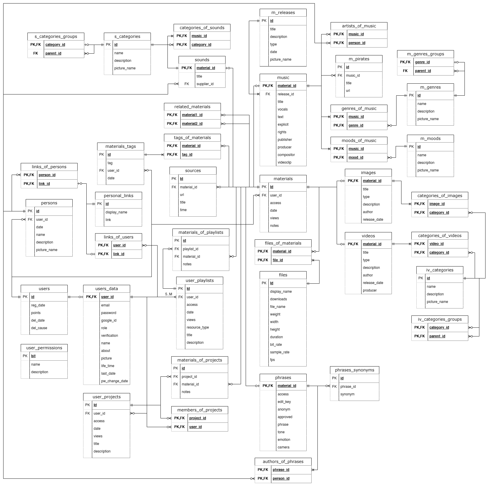
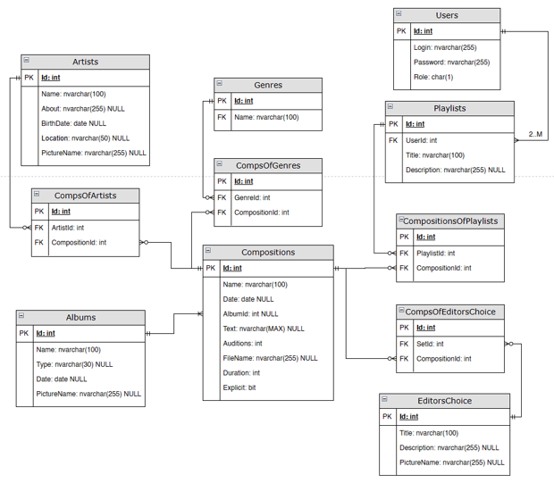
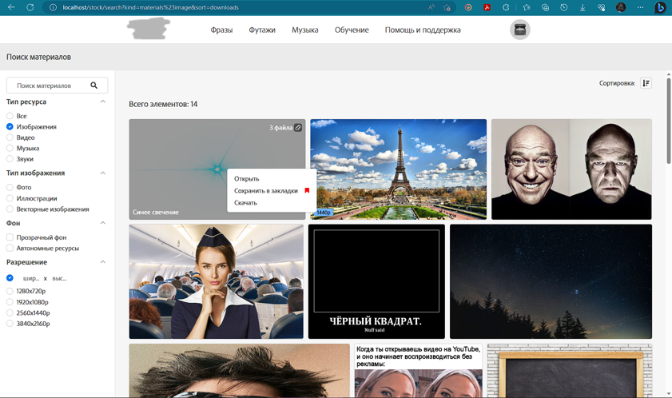
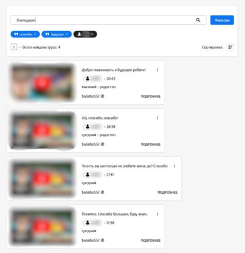
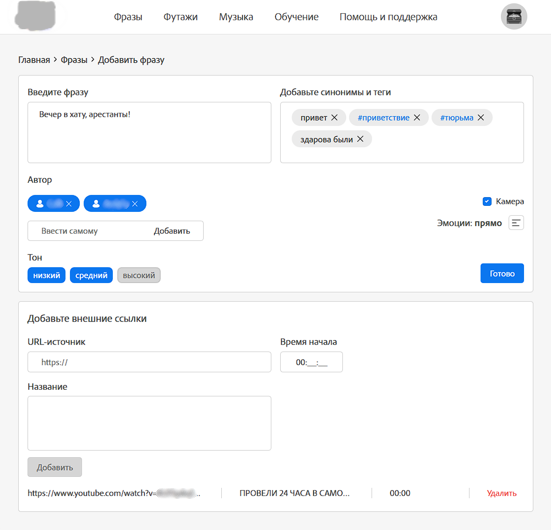
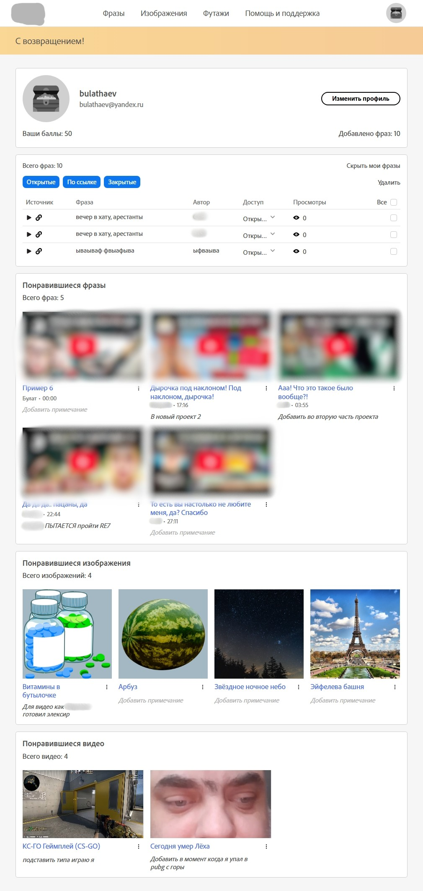
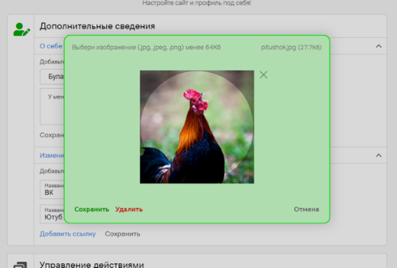
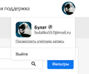

# CreatorAssetHub
Веб-платформа для хранения, поиска и организации ресурсов для создания видео контента: изображений, видео, SFX и VFX-материалов, а также банк цитат медиа-личностей с источниками.
Поддерживает приватный доступ и публикацию по ссылке для пользовательских материалов.

*Период разработки: март 2023 - сентябрь 2023 (архивный R&D / учебный проект).*

Стек: `PHP` • `MySQL` • `JavaScript` • `ES6 Modules` • `Информационное проектирование`

## Архитектура системы и состав репозитория

В ходе эволюции проекта (2021–2023) система прошла архитектурную миграцию от серверного рендеринга (SSR на PHP) к **API-First архитектуре** с полным разделением фронтенда и бэкенда:

* **Кросс-платформенное API:** серверная часть полностью отделена от представления и представлена двумя независимыми API-контурами:
  1. **Основное API платформы** — обслуживает веб-клиент из данного репозитория, а также дочернее SPA-приложение на React (фронтенд SPA в репозиторий не включён).
  2. **Выделенный модуль API для отдельного музыкального сервиса** — находится в отдельной директории и обеспечивает работу нативного UWP-приложения ([UwpMusicClient на GitHub](https://github.com/bkhaev/UwpMusicClient)).
* **Фронтенд:**
  * Клиентская часть веб-платформы построена с использованием **ES6 Modules** и высокоуровневыми компонентами на **Custom Elements** без привлечения тяжелых UI-фреймворков.
  * Сервер настроен (через `.htaccess`) на отдачу статических точек входа `index.html`, после чего UI строится на клиенте асинхронными запросами к API.
  * На страницах поиска реализована SPA-навигация без перезагрузки страницы на базе **History API** с сохранением состояния фильтров в истории браузера.
* **Гранулярный контроль доступа (`user_permissions` и `phrases/details`):**
  * **Битовые маски прав:** система привилегий построена на побитовых операциях (`BIGINT` со степенями двойки), что позволяет хранить и проверять до 64 независимых разрешений в одном числовом поле без лишних JOIN-запросов.
  * **Делегирование доступа:** в кодовой базе сохранён изолированный модуль управления цитатами. Он отключён от основной навигации текущей сборки, но демонстрирует разные механики прав доступа (чтение записей и делегирование прав на редактирование чужого контента по специальным ключам доступа).

## Примечания к публикации

* **Обезличивание и защита данных:** перед публикацией в портфолио оригинальное название проекта, логотип, UI-иконки, а также чувствительный контент (реальные имена/псевдонимы медиа-личностей и пользовательские медиафайлы) были удалены или заменены на нейтральные заглушки.
* **Ограничения запуска:** репозиторий содержит исходный код приложения (PHP, JS) без полного хранилища медиа-ассетов. Ряд вспомогательных модулей оставлен в репозитории исключительно для демонстрации архитектурных решений и работы с API.

## Приложения

_Все имеющиеся модели UML и скриншоты рабочей сборки представлены в папке `docs`._

### Данные
Дампы баз данных представлены в папке `database`.

### ERD

#### Основная база данных

#### База данных музыкального сервиса (отдельный продукт)

### Поиск материалов

### Поиск фраз/цитат

### Сохранение пользовательской цитаты

### Личный кабинет

### Загрузка изображения на аватар

### Меню пользователя в шапке

